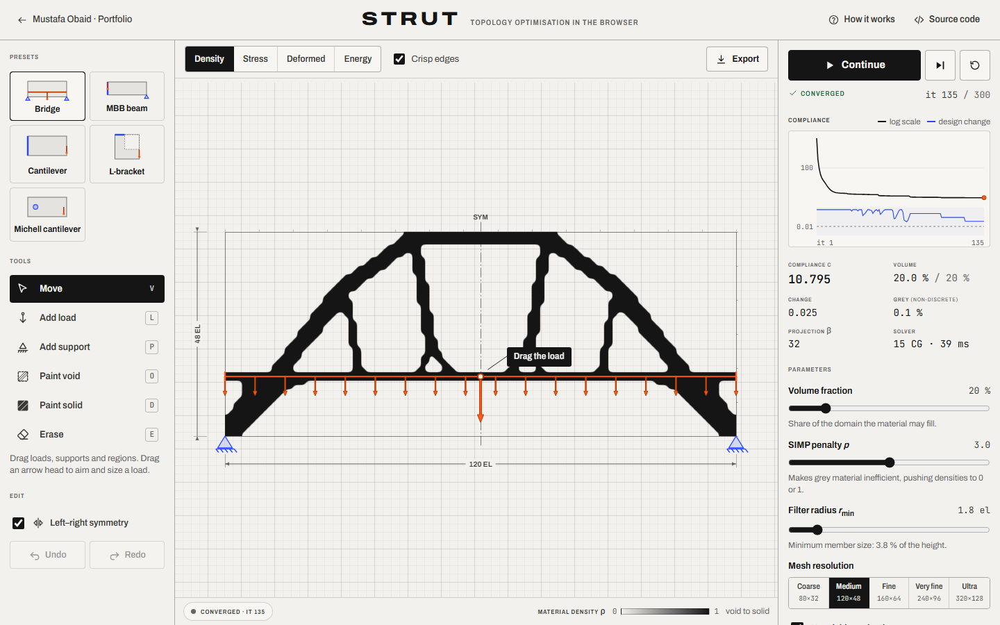

# Strut — topology optimisation in the browser

Place supports and loads, choose how much material you allow, and watch a finite-element
optimiser grow the stiffest structure for it, live, in any modern browser.

**Live demo:** <https://mustafaobaidd1.github.io/strut-topology/>



## The question

If you know where a part is held and where it is pushed, what is the stiffest shape you can make
from a fixed amount of material? Strut answers it the way structural engineers do with density-based
topology optimisation: it splits the design space into thousands of small elements, lets each one
be anything from empty to solid, and repeatedly moves material to where it carries load best. Drag
the load and the answer changes in front of you: lift the bridge deck and a through-arch becomes a
deck arch with spandrel columns.

## Features

- **Opens on a running example**: a bridge with a distributed deck load dissolves from a uniform grey
  block into an arch with hangers in a few seconds. The first affordance is labelled: _Drag the load_.
- **Editor on a structured grid**
  - Supports: fixed, roller sliding in x, roller sliding in y — as points, lines along an edge, or a
    round pin (the Michell preset).
  - Point loads: drag the application point to move one, drag the arrow head to set direction and
    magnitude. Line loads (drag sideways with the load tool) carry a thin solid deck with them.
  - Passive regions: paint _void_ (material must stay out) or _solid_ (material must stay), with a
    brush or a box; an eraser removes items and brushes regions away.
  - Optional left–right symmetry (the passive paint is mirrored too), undo/redo for every edit.
  - Every canvas item is also a focusable button: arrow keys move it, Delete removes it, and an
    inspector edits position, angle, magnitude and support type numerically.
- **Live re-optimisation**: every edit is applied between iterations, warm-started from the current
  design and displacements.
- **Presets**: bridge with a deck load, the MBB beam, a cantilever, an L-bracket and a Michell-type
  cantilever on a round pin.
- **Parameters**: volume fraction, SIMP penalty, filter radius (minimum member size), mesh resolution
  (from 80 × 32 to 320 × 128 elements for the bridge), Heaviside projection with β continuation and a
  final β, and an iteration budget.
- **Run controls and convergence**: run, pause, single step, reset; a live log-scale compliance
  chart with the per-iteration design change against its 0.01 threshold, volume, grey level, β,
  solver iterations and time, and the convergence state (announced to screen readers).
- **Views with legends**: material density, von Mises stress, deformed shape, strain-energy density
  (cividis colour map, scale capped at the 98th percentile).
- **Export for fabrication**: SVG outline (0.5 density contour by marching squares, smoothed, in
  millimetres) for laser cutting or CNC; STL by extrusion (watertight) for 3D printing; PNG of the
  current view with a title block. Files are named like `strut-bridge-120x48-vf20-it128.svg`.
- **88-line reference mode**: a line-by-line port of `top88.m` runs the paper's MBB beam and prints
  the same iteration log, next to the published compliance.
- **How it works** panel with the equations (KaTeX), solver, units, validation table and limitations.
- Designed states: solver starting, solving with progress, converged, iteration limit, ill-posed
  setups with recovery actions, heavy-mesh warning, solver error with restart, export toasts, and
  fallbacks without WebGL2 (Canvas 2D) or without Web Workers (main thread).

## How it works

**Model.** A thin plate in plane stress, linear elastic and isotropic (E₀ = 1, ν = 0.3, unit
thickness), meshed with square bilinear Q4 elements of unit size. The element stiffness for unit
modulus is the closed form of Andreassen et al. (2011), identical to 2 × 2 Gauss integration of
∫ BᵀDB dA (checked in the tests).

**Problem.** Minimise the compliance c = Fᵀu = Σₑ Eₑ uₑᵀk₀uₑ subject to K(x̄)u = F, a volume
budget (1/N)Σₑ x̄ₑ ≤ f over the whole domain (passive solids count against it) and 0 ≤ xₑ ≤ 1.

**SIMP.** Eₑ = E_min + x̄ₑᵖ(E₀ − E_min) with E_min = 10⁻⁹ and p = 3 by default, which makes grey
material inefficient.

**Sensitivity.** Compliance is self-adjoint: ∂c/∂x̄ₑ = −p x̄ₑᵖ⁻¹(E₀ − E_min) uₑᵀk₀uₑ, then chained
back through the projection and the filter.

**Density filter** (Bruns & Tortorelli 2001): x̃ₑ = Σᵢ Hₑᵢxᵢ / Σᵢ Hₑᵢ with
Hₑᵢ = max(0, r_min − Δ(e, i)). The radius sets the minimum member size; it is given in element widths
and rescaled when the mesh changes so the physical size stays put.

**Heaviside projection** (Wang, Lazarov & Sigmund 2011):
x̄ = [tanh(βη) + tanh(β(x̃ − η))] / [tanh(βη) + tanh(β(1 − η))], η = 0.5. β starts at 1 and doubles
every 25 iterations or as soon as the design settles, up to its final value (32 by default). After
an edit β drops to at most 2 so the design can still change topology.

**Optimality criteria.** xₑ ← clamp(xₑ√Bₑ, max(0, xₑ − m), min(1, xₑ + m)) with
Bₑ = −(∂c/∂xₑ)/(λ ∂V/∂xₑ) and move limit m = 0.2. The multiplier λ meets the volume exactly: by
bisection in the reference mode (as in the paper) and by a bracketed Illinois search on log λ,
warm-started from the previous λ, in interactive mode. With a sharp projection (β > 4) the move
limit shrinks as 0.2 · 4/β: otherwise boundary elements flip by the full move limit every
iteration while the compliance stays flat. A run stops when no design variable moves by more than
0.01, or when the mean compliance of the last 8 iterations is within 0.01 % of the 8 before (once
β is final), or at the iteration budget.

**Solver.** Conjugate gradients with a matrix-free, element-by-element product, warm-started from
the previous displacement and preconditioned by one geometric multigrid V-cycle: bilinear
prolongation (rows of fixed DOFs zeroed), Galerkin coarse operators PᵀKP formed element by element
(which keeps the 10⁹ stiffness contrast of void regions on every level), symmetric point-block
Gauss–Seidel smoothing and a banded Cholesky factorisation on the coarsest grid. It converges to a
relative residual of 10⁻⁶ in about 10–30 iterations. Everything runs in a module Web Worker on
typed arrays; the UI receives the physical densities (and the field of the active view) after each
iteration and interpolates between them while the next one is computed.

**Units.** Dimensionless: E₀ = 1, unit thickness and element size, loads of order 1 (reference
F = 1). Compliance scales with the square of the loads; stresses are in F per element width.
Line loads are consistent nodal forces (trapezoidal weights) on a two-element solid deck.

**Outlines.** The element field, padded with empty cells, is contoured at 0.5 by marching squares
(saddles resolved by the cell average), loops shorter than 1.5 element areas are dropped, smoothed
with Taubin λ|μ steps (no shrinkage), simplified by Ramer–Douglas–Peucker and written as
Catmull–Rom cubic Béziers. The STL extrudes the same loops: faces triangulated with earcut, side
walls from the loop edges, watertight by construction.

## Validation

**Kind of tool:** an educational design tool implementing a published method, **not** a certified
engineering calculator. The finite elements, the gradient and the optimiser are verified against
closed-form results and published values below; real parts need stress, buckling, fatigue and
manufacturing checks that Strut does not do.

Unit tests (`npm test`, 79 tests) cover the checks marked _unit_; `npm run validate` runs the slower
ones and writes [docs/validation-results.md](docs/validation-results.md).

| Check                                                                           | Reference                                     | Result                                                                                                                                  |
| ------------------------------------------------------------------------------- | --------------------------------------------- | --------------------------------------------------------------------------------------------------------------------------------------- |
| Patch test (8 × 4 mesh, direct, MGCG and Jacobi-PCG) _unit_                     | exact linear field                            | nodal error 1.4 × 10⁻¹⁷, 1.0 × 10⁻¹⁷, 7.1 × 10⁻¹⁶; element stresses exact                                                               |
| Element matrix _unit_                                                           | 2 × 2 Gauss integration of BᵀDB               | equal to 10⁻¹⁴; exactly 3 zero (rigid-body) modes                                                                                       |
| Cantilever L/H = 8, clamped, parabolic end shear _unit_                         | Timoshenko beam theory (κ = 5/6), δ = 2072.96 | 2, 4, 8, 16, 32, 64 elements deep: −11.29 %, −3.32 %, −1.04 %, −0.44 %, −0.28 %, −0.24 %                                                |
| Same beam, root displacements from the elasticity solution _unit_               | Timoshenko & Goodier plane-stress solution    | max displacement error 10.8 %, 2.95 %, 0.754 %, 0.190 %, 0.0475 %, 0.0119 %: second order (observed rates 1.87, 1.97, 1.99, 2.00, 2.00) |
| Compliance gradient (density filter; projection β = 4; passive elements) _unit_ | central finite differences                    | max relative error 8.5 × 10⁻⁸, 6.0 × 10⁻⁷, 1.3 × 10⁻⁷ (bound 10⁻⁵)                                                                      |
| Symmetric bridge, symmetry not imposed _unit_                                   | mirror symmetry                               | 96 × 32 after 100 iterations (validate): max asymmetry 1.5 × 10⁻¹⁰ with the direct solver, 1.1 × 10⁻⁷ with MGCG                         |
| 88-line code, MBB 60 × 20, ft = 1, r_min 2.4 _unit_                             | c = 216.81 (Andreassen et al. 2011, Fig. 3)   | **216.81** (216.8137, 106 iterations)                                                                                                   |
| Same, density filter ft = 2 _unit_                                              | c = 233.71                                    | **233.71** (233.7146, 144 iterations; also with MGCG)                                                                                   |
| Same, Heaviside variant ft = 3, r_min 1.8 _unit_                                | c = 189.14 (Fig. 5)                           | **189.14** (189.1405, 409 iterations, β = 512)                                                                                          |
| 88-line code, MBB 150 × 50, r_min 6, ft = 1 / ft = 2                            | c = 219.52 / 235.73                           | **219.52** (219.5199, 95 iterations) / **235.73** (235.7337, 362 iterations)                                                            |
| Interactive engine (MGCG, Illinois λ search) in the 60 × 20 ft = 2 settings     | c = 233.71                                    | 233.71 (233.7125, 146 iterations)                                                                                                       |
| First iteration (uniform x = 0.5) _unit_                                        | c_solid / E(0.5), deterministic               | 1007.0221 for ft 1 and 2 (1033.0446 at 150 × 50), identity to 10⁻¹⁰                                                                     |

Solver cost on an Intel i9-14900HX in Node 24 (bridge preset, projection on): 19 ms per optimisation
iteration at 80 × 32 elements, 36 ms at 120 × 48, 70 ms at 160 × 64, 157 ms at 240 × 96 and 453 ms
at 320 × 128, with 12–17 CG iterations per solve at every size (full table in the results file).

The clamped cantilever converges about 0.24 % below beam theory because a fully clamped edge also
stops the Poisson contraction at the wall; with exact boundary data the error falls at second order,
as expected for Q4 elements. The 88-line reference values were checked to the printed precision
(two decimals); the published figures do not use r_min = 1.5 (the call quoted in the paper's text),
so no reference value is claimed for it.

## Limitations

- Linear elasticity, small displacements and plane stress in a plate of uniform thickness.
- Compliance (stiffness) is the only objective: no stress, buckling, fatigue or displacement
  constraints, and one load case (all loads act together).
- Density methods find local optima; the design depends on the filter radius, penalty and
  continuation schedule. The relaxed move limit at high β and the compliance-stall stopping rule are
  practical choices, not part of the 88-line method (the reference mode does not use them).
- Stresses are those of the SIMP model at element centres: meaningless in grey material and
  singular at point loads and re-entrant corners (hence the capped colour scale).
- Manufacturing realism is limited to a minimum member size: no overhang, tool-access or
  drilling rules, and small holes can survive a sharp projection. Exported outlines are a starting
  point for CAD, not a finished part.
- Square elements on a rectangular domain only; the finest meshes are slow on phones (Strut warns).

## Prior art

- **DTU TopOpt App** (Aage, Nobel-Jørgensen, Andreasen & Sigmund 2013): the reference for
  interactive topology optimisation — drag loads and supports and watch the design follow, on phones,
  tablets, desktops and the web (Unity/C#). It is more polished and also does 3D. Strut differs in
  being open source and browser-native, exposing the filter radius, penalty, projection and mesh,
  adding stress, energy and deformation views, a reference mode that reproduces the published
  numbers, and SVG/STL export for fabrication.
- **top88 / top99 / top99neo** (Andreassen et al. 2011; Sigmund 2001; Ferrari & Sigmund 2020): the
  MATLAB teaching codes whose method Strut implements and whose results its reference mode
  reproduces. They are scripts, not interactive editors.
- **A web-based topology optimization program** (Tcherniak & Sigmund 2001): an early Java applet of
  the 99-line method in the browser.
- **CloudTopopt** (University of Wisconsin–Madison, 2015): a cloud service for 3D topology
  optimisation with a WebGL front end; the optimisation runs on servers, Strut runs entirely on the
  device.
- Commercial generative-design tools (e.g. Autodesk Fusion, Altair Inspire) handle 3D, multiple
  load cases and manufacturing constraints at a level Strut does not attempt.

## Tech stack and architecture

Vite 8, Svelte 5 (runes) and TypeScript (strict); no runtime framework beyond Svelte. KaTeX is
loaded only with the How it works panel; earcut for STL faces.

```
src/lib/fem        Q4 element, grid numbering, element-by-element operator, stencil assembly,
                   banded Cholesky, PCG, geometric multigrid, solver facade, post-processing
src/lib/opt        hat filter, projections, OC update, interactive optimiser, top88 port
src/lib/problem    resolution-independent problem model, meshing, validation, presets
src/lib/geometry   marching squares, smoothing, SVG and STL exporters
src/lib/engine     worker protocol and the engine host (runs in the worker or on the main thread)
src/worker         module Web Worker entry
src/state          app state (runes), frame store, solver client with fallback
src/ui             components; render/ holds the WebGL2 renderer, the Canvas 2D fallback and the
                   CAD overlay
```

The UI thread never solves: it resolves edits to grid arrays, posts them to the worker, and draws
what comes back with WebGL2 (smooth B-spline sampling of the density texture and an anti-aliased
0.5 iso-line once the design is nearly black and white).

## Run locally

```bash
npm install
npm run dev          # http://localhost:5304/strut-topology/
npm test             # unit tests (Vitest)
npm run test:e2e     # Playwright, desktop and mobile, with axe accessibility checks
npm run build        # production build in dist/
npm run validate     # slow validation suite → docs/validation-results.md
npm run screenshots  # README screenshots and the social image (after a build)
npm run check        # lint, typecheck (svelte-check), Prettier, unit tests, build, E2E
```

## Accessibility notes

- Semantic landmarks, one `h1`, labelled controls, visible focus rings and WCAG 2.2 AA contrast
  (axe runs in the E2E suite on desktop and mobile). Orange load graphics carry a darker outline to
  meet the 3:1 contrast for essential graphics.
- Full keyboard operation: tools, views and run controls have shortcuts; every load, support and
  region on the canvas is a focusable button moved with the arrow keys and removed with Delete; the
  inspector edits values numerically.
- State changes (converged, paused, iteration limit) are announced through a polite live region,
  not every iteration; the chart has a text summary.
- `prefers-reduced-motion`: the optimisation does not start by itself and is not animated; a clear
  _Optimise this design_ button runs it and the result appears when it finishes.
- Touch targets of at least 44 × 44 px for primary controls; the phone layout puts the tools in a
  bottom bar within thumb reach and everything else in a sheet.

## Credits & licences

- Method: Andreassen, Clausen, Schevenels, Lazarov & Sigmund, _Efficient topology optimization in
  MATLAB using 88 lines of code_, Struct Multidisc Optim 43:1–16 (2011); Bendsøe & Sigmund,
  _Topology Optimization_ (2003); Bruns & Tortorelli (2001) density filter; Wang, Lazarov & Sigmund
  (2011) projection; Amir, Aage & Lazarov (2014) multigrid-preconditioned CG; Sigmund (2007)
  grey-level measure; Timoshenko & Goodier, _Theory of Elasticity_ (cantilever solution). The code
  is an original TypeScript implementation.
- Fonts: [Archivo](https://github.com/Omnibus-Type/Archivo) (Omnibus-Type) and
  [JetBrains Mono](https://github.com/JetBrains/JetBrainsMono), SIL Open Font License 1.1, self-hosted
  via Fontsource.
- [KaTeX](https://katex.org/) (MIT) for equations; [earcut](https://github.com/mapbox/earcut)
  (ISC) for polygon triangulation.
- Colour map: cividis (Nuñez, Anderton & Renslow, PLOS ONE 13(7): e0199239, 2018), 17 samples of
  [Matplotlib](https://matplotlib.org/)'s table (Matplotlib licence, BSD-compatible).
- Svelte, Vite, Vitest and Playwright under their MIT/Apache-2.0 licences.

## License

MIT — see [LICENSE](LICENSE).
